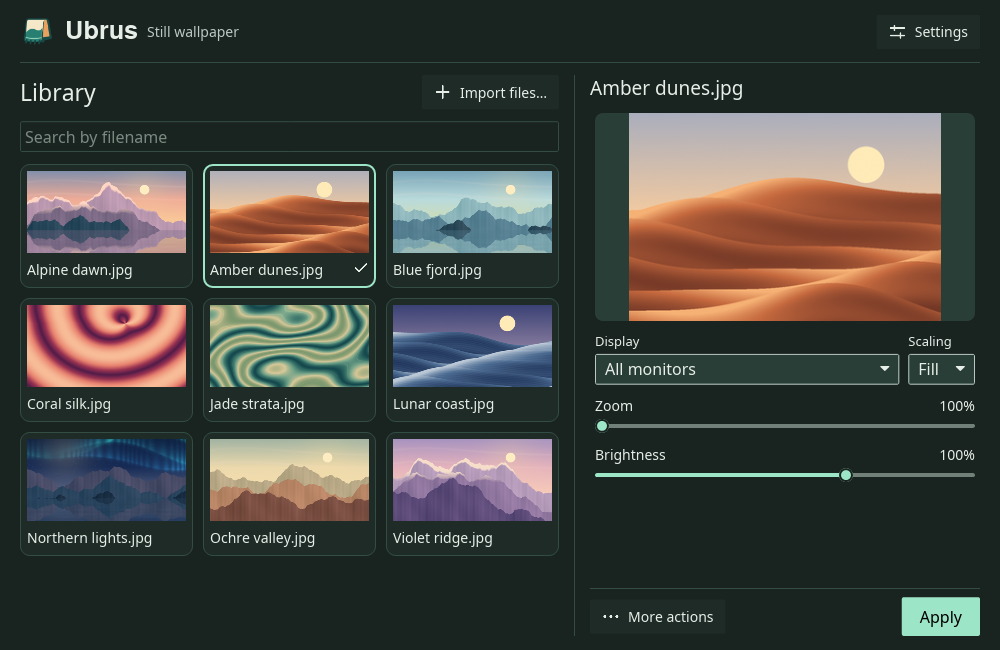

# Ubrus

**English** · [Русский](docs/README.ru.md)

[](https://github.com/ivangor246/ubrus/actions/workflows/ci.yml)
[](https://github.com/ivangor246/ubrus/releases/latest)
[](#installation)
[](#installation)
[](#project)

Give each GNOME monitor its own wallpaper using a photo, an animation (GIF or WebP) or a looping video. Playback pauses on any monitor where windows completely cover the background.

**[Download for Ubuntu (.deb, amd64)](https://github.com/ivangor246/ubrus/releases/latest/download/ubrus-amd64.deb)** · [All release files](https://github.com/ivangor246/ubrus/releases/latest)



## Installation

Open the downloaded DEB in App Center or run `sudo apt install ./ubrus-amd64.deb` from its folder.

A single photo works across all monitors immediately. For animation or a different wallpaper on each monitor, sign out of GNOME, sign back in and enable the bundled extension.

```sh
gnome-extensions enable wallpaper@ubrus.org
```

Using the Snap or standalone archive? Open **Settings** in Ubrus and copy the command to install the extension first.

## Set a wallpaper

Open Ubrus and choose **Import files…** to add images or videos. Select a thumbnail and a monitor, adjust the zoom if needed, then click **Apply**. The wallpaper stays on the desktop when you close the window.

## Project

[Build from source](docs/development.md) · [Report a bug](https://github.com/ivangor246/ubrus/issues) · [MIT](LICENSE-MIT) or [Apache 2.0](LICENSE-APACHE)

**Tags** · [wallpaper-manager](https://github.com/topics/wallpaper-manager) · [animated-wallpaper](https://github.com/topics/animated-wallpaper) · [gnome-shell-extension](https://github.com/topics/gnome-shell-extension) · [rust](https://github.com/topics/rust)
