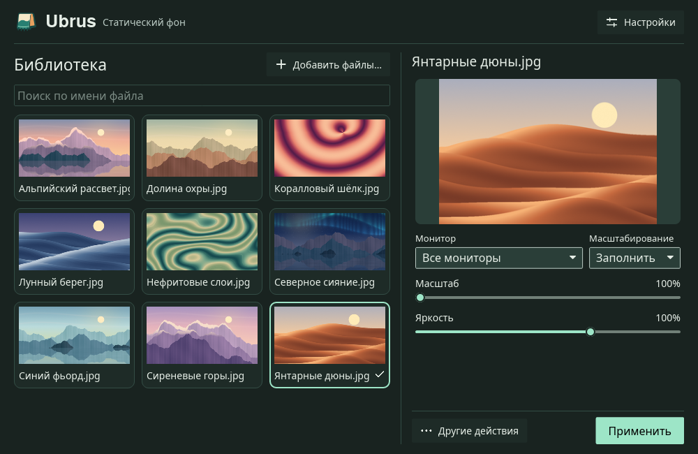

# Ubrus

[](https://github.com/ivangor246/ubrus/actions/workflows/ci.yml)
[](https://github.com/ivangor246/ubrus/releases/latest)
[](#установка-в-ubuntu)
[](#установка-в-ubuntu)
[](#лицензия)

[English](../README.md) · **Русский**

Ubrus устанавливает фотографии, зацикленные видео и GIF на рабочий стол Ubuntu GNOME. Можно выбрать общий фон или отдельные обои для каждого монитора. На полностью закрытом окнами экране анимация приостанавливается, а на видимом продолжает играть.



## Установка в Ubuntu

Для Ubuntu 24.04 (GNOME Shell 46) и 26.04 (GNOME Shell 50) на amd64 [скачайте DEB](https://github.com/ivangor246/ubrus/releases/latest/download/ubrus-amd64.deb). В него входит расширение GNOME. Откройте файл в Центре приложений или выполните команду в каталоге с пакетом.

```sh
sudo apt install ./ubrus-amd64.deb
```

Откройте **Ubrus** из меню приложений. Статичное изображение сразу можно установить на все мониторы. Для анимации или отдельных фонов выйдите из сеанса, войдите снова и включите расширение.

```sh
gnome-extensions enable wallpaper@ubrus.org
```

<details>
<summary>Отдельный архив, Snap и контрольные суммы</summary>

В [архив для Linux](https://github.com/ivangor246/ubrus/releases/latest/download/ubrus-linux-amd64.tar.gz) входят исполняемый файл, ZIP с расширением и лицензии. Распакуйте архив в постоянный каталог и запустите в нём `./ubrus`. Приложению нужны системные библиотеки GTK 4 и GStreamer. Установите расширение командой `gnome-extensions install ./ubrus-extension.zip`.

Доступные каналы Snap показывает `snap info ubrus`. После публикации стабильной ревизии выполните `sudo snap install ubrus`. Установите расширение командой `gnome-extensions install /snap/ubrus/current/share/ubrus/ubrus-extension.zip`. Чтобы заменить старую копию после обновления Snap, добавьте `--force` после `install`. Выйдите из сеанса, войдите снова и включите расширение командой выше.

На [странице выпуска](https://github.com/ivangor246/ubrus/releases/latest) можно скачать расширение отдельно. Сохраните [SHA256SUMS](https://github.com/ivangor246/ubrus/releases/latest/download/SHA256SUMS) из того же выпуска рядом с файлами и выполните `sha256sum --check --ignore-missing SHA256SUMS`.

</details>

## Как установить обои

1. Нажмите **Добавить файлы** (**Ctrl+O**), выберите один или несколько файлов, затем нажмите на миниатюру. Поддерживаются PNG, JPEG, статичные и анимированные GIF и WebP, MP4 с H.264 и WebM с VP8 или VP9. Библиотека хранит копии файлов и поддерживает поиск по имени. Если остановить импорт, уже добавленные файлы останутся в библиотеке.
2. Выберите монитор и режим **Вписать** или **Заполнить**. Перетащите изображение в области предпросмотра или используйте **Shift+стрелки**. Настройте масштаб и яркость. Для видео и анимированных изображений доступны предпросмотр без звука и выбор скорости.
3. Нажмите **Применить** (**Ctrl+Enter**). После закрытия окна обои продолжат работать. При первой установке анимации Ubrus включает запуск при входе, если вы ещё не выбирали эту настройку.

В меню **Другие действия** можно сбросить назначение, скрыть или восстановить обои, удалить выбранную копию из библиотеки. При скрытии Ubrus возвращает системный фон и сохраняет назначение и настройки обоев. Версия из DEB перед восстановлением проверяет, что текущий фон установила именно она. Версия Snap использует расширение и для статичных изображений, когда оно доступно. Ранее установленный через портал фон, владельца которого Snap не может проверить, можно изменить в настройках GNOME.

Из меню верхней панели GNOME можно открыть Ubrus, приостановить или возобновить анимацию, скрыть или восстановить фон, включить или отключить приложение. При отключении приложения отключается и автозапуск. Значок можно скрыть и вернуть в **Настройках** (**Ctrl+,**).

В настройках также можно выбрать язык и тему, настроить энергосбережение и воспроизведение в обзоре GNOME. В **Диагностике** (**Ctrl+D**) можно выделять и копировать текст, а также сохранять отчёт. После обновления DEB нажмите **Применить обновление** в настройках. Локальный DEB с тем же номером версии можно переустановить командой `sudo dpkg -i ./ubrus-amd64.deb`. GNOME загрузит заменённое расширение при следующем входе.

## Разработка и поддержка

**Теги** · [wallpaper-manager](https://github.com/topics/wallpaper-manager) · [animated-wallpaper](https://github.com/topics/animated-wallpaper) · [gnome-shell-extension](https://github.com/topics/gnome-shell-extension) · [rust](https://github.com/topics/rust)

Команда `make release` собирает исполняемый файл и расширение. [Руководство разработчика](development.md) описывает зависимости, упаковку и выпуск. В [руководстве по тестам](../tests/README.md) описаны проверки рабочего стола и замеры воспроизведения. В [сообщении об ошибке](https://github.com/ivangor246/ubrus/issues) укажите версию Ubuntu, способ установки и шаги для воспроизведения. Кнопка **Скопировать публичный отчёт** в диагностике подготовит статистику воспроизведения и мониторов. Имена файлов, пути и журнал действий останутся на компьютере.

## Лицензия

Проект доступен на условиях [MIT](../LICENSE-MIT) или [Apache 2.0](../LICENSE-APACHE). В комплекты с исполняемым файлом входят уведомления о лицензиях сторонних компонентов.
