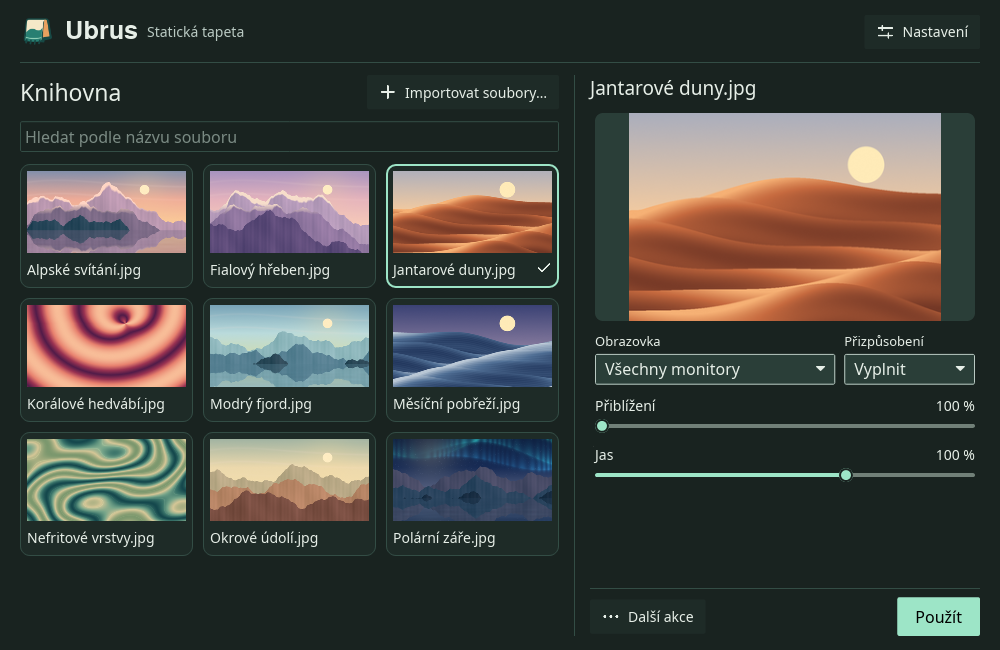

# Ubrus

[English](../../README.md) · [Русский](README.ru.md) · **Čeština** · [Deutsch](README.de.md) · [Bahasa Indonesia](README.id.md) · [Italiano](README.it.md) · [Nederlands](README.nl.md) · [Português (Portugal)](README.pt-PT.md) · [Türkçe](README.tr.md) · [日本語](README.ja.md) · [한국어](README.ko.md) · [简体中文](README.zh-Hans.md) · [繁體中文](README.zh-Hant.md)

[](https://github.com/ivangor246/ubrus/actions/workflows/ci.yml)
[](https://github.com/ivangor246/ubrus/releases/latest)
[](#instalace)
[](#instalace)
[](#projekt)

Nastavte si v GNOME pro každý monitor vlastní fotku, animaci (GIF nebo WebP) nebo video ve smyčce. Na monitoru, kde okna zcela zakryjí pozadí, se přehrávání pozastaví.

**[Stáhnout pro Ubuntu (.deb, amd64)](https://github.com/ivangor246/ubrus/releases/latest/download/ubrus-amd64.deb)** · [Všechny soubory vydání](https://github.com/ivangor246/ubrus/releases/latest)



## Instalace

Otevřete stažený balíček DEB v Centru aplikací nebo v jeho složce spusťte `sudo apt install ./ubrus-amd64.deb`.

Jednu fotku můžete ihned nastavit pro všechny monitory. Chcete-li animaci nebo jinou tapetu na každém monitoru, odhlaste se z GNOME, znovu se přihlaste a povolte přibalené rozšíření.

```sh
gnome-extensions enable wallpaper@ubrus.org
```

Používáte Snap nebo samostatný archiv? Nejprve v Ubrus otevřete **Nastavení** a zkopírujte příkaz k instalaci rozšíření.

## Nastavení tapety

V Ubrus zvolte **Importovat soubory…** a přidejte obrázky nebo videa. Vyberte miniaturu a monitor, případně upravte přiblížení a klikněte na **Použít**. Po zavření okna tapeta zůstane na ploše.

## Projekt

[Sestavení ze zdrojového kódu](../development.md) · [Nahlásit chybu](https://github.com/ivangor246/ubrus/issues) · [MIT](../../LICENSE-MIT) nebo [Apache 2.0](../../LICENSE-APACHE)

**Štítky** · [wallpaper-manager](https://github.com/topics/wallpaper-manager) · [animated-wallpaper](https://github.com/topics/animated-wallpaper) · [gnome-shell-extension](https://github.com/topics/gnome-shell-extension) · [rust](https://github.com/topics/rust)
