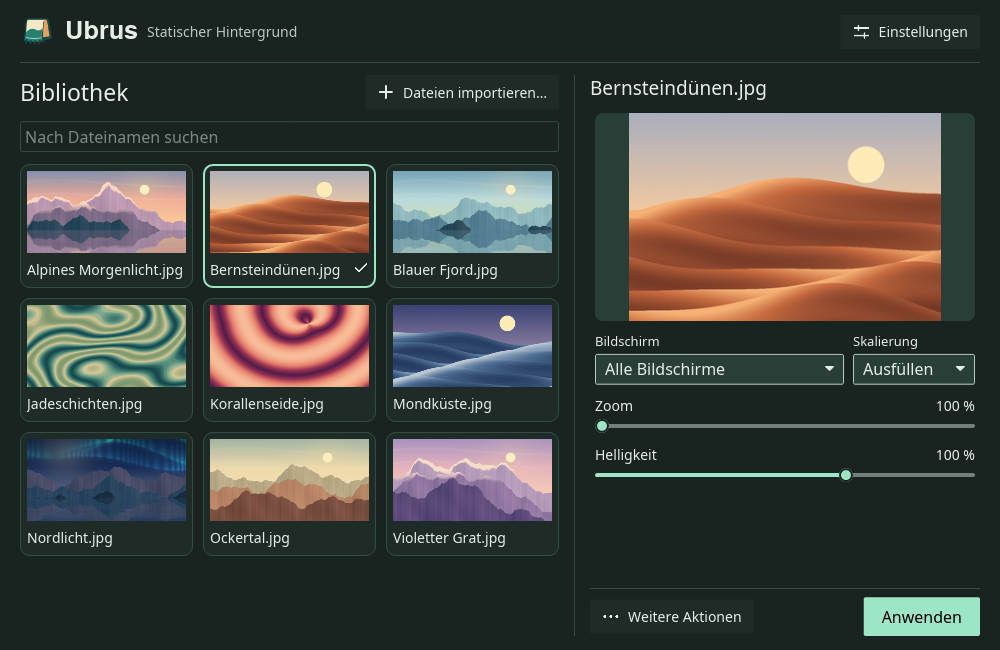

# Ubrus

[English](../../README.md) · [Русский](README.ru.md) · [Čeština](README.cs.md) · **Deutsch** · [Bahasa Indonesia](README.id.md) · [Italiano](README.it.md) · [Nederlands](README.nl.md) · [Português (Portugal)](README.pt-PT.md) · [Türkçe](README.tr.md) · [日本語](README.ja.md) · [한국어](README.ko.md) · [简体中文](README.zh-Hans.md) · [繁體中文](README.zh-Hant.md)

[](https://github.com/ivangor246/ubrus/actions/workflows/ci.yml)
[](https://github.com/ivangor246/ubrus/releases/latest)
[](#installation)
[](#installation)
[](#projekt)

Wählen Sie für jeden Bildschirm unter GNOME ein eigenes Foto, eine Animation (GIF oder WebP) oder ein Video in Endlosschleife. Verdecken Fenster den Hintergrund eines Bildschirms vollständig, pausiert dort die Wiedergabe.

**[Für Ubuntu herunterladen (.deb, amd64)](https://github.com/ivangor246/ubrus/releases/latest/download/ubrus-amd64.deb)** · [Alle Dateien dieser Version](https://github.com/ivangor246/ubrus/releases/latest)



## Installation

Öffnen Sie das heruntergeladene DEB-Paket im App-Zentrum oder führen Sie in seinem Ordner `sudo apt install ./ubrus-amd64.deb` aus.

Ein Foto für alle Bildschirme können Sie sofort festlegen. Für Animationen oder unterschiedliche Hintergründe pro Bildschirm melden Sie sich von GNOME ab und wieder an und aktivieren dann die mitgelieferte Erweiterung.

```sh
gnome-extensions enable wallpaper@ubrus.org
```

Wenn Sie den Snap oder das eigenständige Archiv verwenden, öffnen Sie in Ubrus die **Einstellungen** und kopieren Sie den Befehl, um zuerst die Erweiterung zu installieren.

## Hintergrundbild festlegen

Wählen Sie in Ubrus **Dateien importieren…**, um Bilder oder Videos hinzuzufügen. Wählen Sie ein Vorschaubild und einen Bildschirm, passen Sie bei Bedarf den Zoom an und klicken Sie auf **Anwenden**. Das Hintergrundbild bleibt beim Schließen des Fensters erhalten.

## Projekt

[Aus dem Quellcode bauen](../development.md) · [Fehler melden](https://github.com/ivangor246/ubrus/issues) · [MIT](../../LICENSE-MIT) oder [Apache 2.0](../../LICENSE-APACHE)

**Schlagwörter** · [wallpaper-manager](https://github.com/topics/wallpaper-manager) · [animated-wallpaper](https://github.com/topics/animated-wallpaper) · [gnome-shell-extension](https://github.com/topics/gnome-shell-extension) · [rust](https://github.com/topics/rust)
