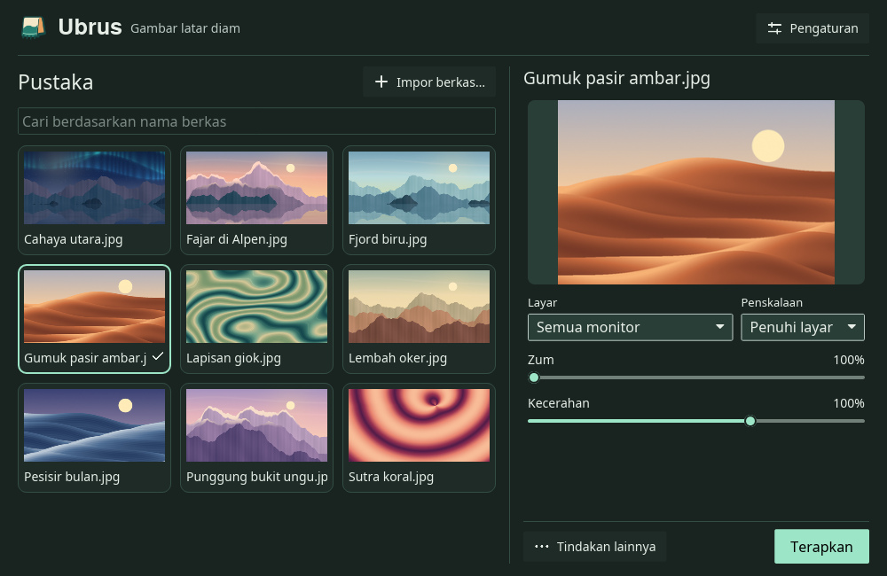

# Ubrus

[English](../../README.md) · [Русский](README.ru.md) · [Čeština](README.cs.md) · [Deutsch](README.de.md) · **Bahasa Indonesia** · [Italiano](README.it.md) · [Nederlands](README.nl.md) · [Português (Portugal)](README.pt-PT.md) · [Türkçe](README.tr.md) · [日本語](README.ja.md) · [한국어](README.ko.md) · [简体中文](README.zh-Hans.md) · [繁體中文](README.zh-Hant.md)

[](https://github.com/ivangor246/ubrus/actions/workflows/ci.yml)
[](https://github.com/ivangor246/ubrus/releases/latest)
[](#pemasangan)
[](#pemasangan)
[](#proyek)

Atur foto, animasi (GIF atau WebP), atau video berulang sebagai latar tersendiri untuk setiap monitor di GNOME. Pemutaran dijeda pada monitor yang latarnya tertutup sepenuhnya oleh jendela.

**[Unduh untuk Ubuntu (.deb, amd64)](https://github.com/ivangor246/ubrus/releases/latest/download/ubrus-amd64.deb)** · [Semua berkas rilis](https://github.com/ivangor246/ubrus/releases/latest)



## Pemasangan

Buka paket DEB yang telah diunduh di Pusat Aplikasi, atau jalankan `sudo apt install ./ubrus-amd64.deb` dari folder tempat paket disimpan.

Anda dapat langsung menggunakan satu foto untuk semua monitor. Untuk animasi atau gambar latar berbeda pada tiap monitor, keluar dari sesi GNOME, masuk kembali, lalu aktifkan ekstensi yang disertakan.

```sh
gnome-extensions enable wallpaper@ubrus.org
```

Jika menggunakan Snap atau arsip mandiri, buka **Pengaturan** di Ubrus dan salin perintah untuk memasang ekstensi terlebih dahulu.

## Mengatur gambar latar

Buka Ubrus dan pilih **Impor berkas…** untuk menambahkan gambar atau video. Pilih gambar mini dan monitor, sesuaikan tingkat zum bila perlu, lalu klik **Terapkan**. Gambar latar tetap terpasang setelah jendela ditutup.

## Proyek

[Bangun dari kode sumber](../development.md) · [Laporkan bug](https://github.com/ivangor246/ubrus/issues) · [MIT](../../LICENSE-MIT) atau [Apache 2.0](../../LICENSE-APACHE)

**Tag** · [wallpaper-manager](https://github.com/topics/wallpaper-manager) · [animated-wallpaper](https://github.com/topics/animated-wallpaper) · [gnome-shell-extension](https://github.com/topics/gnome-shell-extension) · [rust](https://github.com/topics/rust)
