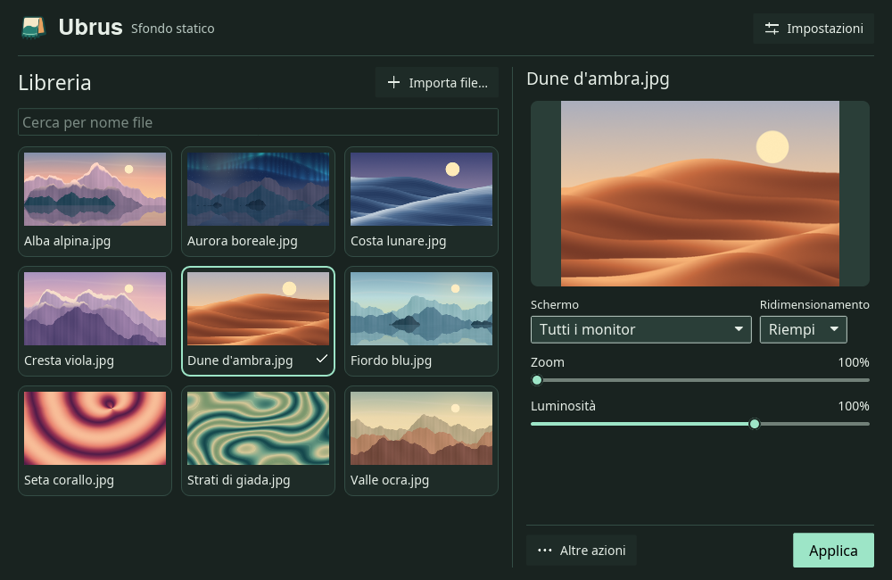

# Ubrus

[English](../../README.md) · [Русский](README.ru.md) · [Čeština](README.cs.md) · [Deutsch](README.de.md) · [Bahasa Indonesia](README.id.md) · **Italiano** · [Nederlands](README.nl.md) · [Português (Portugal)](README.pt-PT.md) · [Türkçe](README.tr.md) · [日本語](README.ja.md) · [한국어](README.ko.md) · [简体中文](README.zh-Hans.md) · [繁體中文](README.zh-Hant.md)

[](https://github.com/ivangor246/ubrus/actions/workflows/ci.yml)
[](https://github.com/ivangor246/ubrus/releases/latest)
[](#installazione)
[](#installazione)
[](#progetto)

Scegli per ogni monitor di GNOME una foto, un'animazione (GIF o WebP) o un video in loop. La riproduzione si interrompe sui monitor in cui le finestre coprono completamente lo sfondo.

**[Scarica per Ubuntu (.deb, amd64)](https://github.com/ivangor246/ubrus/releases/latest/download/ubrus-amd64.deb)** · [Tutti i file della versione](https://github.com/ivangor246/ubrus/releases/latest)



## Installazione

Apri il DEB scaricato nel Centro applicazioni oppure esegui `sudo apt install ./ubrus-amd64.deb` dalla cartella che lo contiene.

Puoi usare subito una foto su tutti i monitor. Per le animazioni o per usare sfondi diversi, termina la sessione GNOME, accedi di nuovo e abilita l'estensione inclusa.

```sh
gnome-extensions enable wallpaper@ubrus.org
```

Se usi lo Snap o l'archivio autonomo, apri **Impostazioni** in Ubrus e copia il comando per installare prima l'estensione.

## Impostare uno sfondo

Apri Ubrus e scegli **Importa file…** per aggiungere immagini o video. Seleziona una miniatura e un monitor, regola lo zoom se necessario e premi **Applica**. Lo sfondo resta sulla scrivania quando chiudi la finestra.

## Progetto

[Compilare dai sorgenti](../development.md) · [Segnalare un problema](https://github.com/ivangor246/ubrus/issues) · [MIT](../../LICENSE-MIT) o [Apache 2.0](../../LICENSE-APACHE)

**Tag** · [wallpaper-manager](https://github.com/topics/wallpaper-manager) · [animated-wallpaper](https://github.com/topics/animated-wallpaper) · [gnome-shell-extension](https://github.com/topics/gnome-shell-extension) · [rust](https://github.com/topics/rust)
