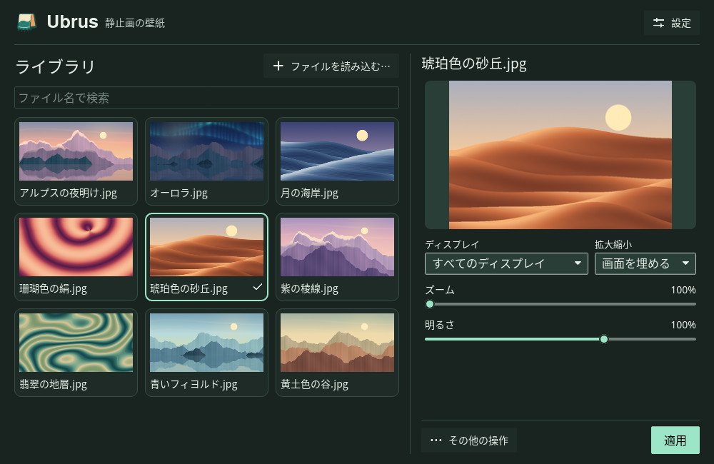

# Ubrus

[English](../../README.md) · [Русский](README.ru.md) · [Čeština](README.cs.md) · [Deutsch](README.de.md) · [Bahasa Indonesia](README.id.md) · [Italiano](README.it.md) · [Nederlands](README.nl.md) · [Português (Portugal)](README.pt-PT.md) · [Türkçe](README.tr.md) · **日本語** · [한국어](README.ko.md) · [简体中文](README.zh-Hans.md) · [繁體中文](README.zh-Hant.md)

[](https://github.com/ivangor246/ubrus/actions/workflows/ci.yml)
[](https://github.com/ivangor246/ubrus/releases/latest)
[](#インストール)
[](#インストール)
[](#プロジェクト)

GNOME のディスプレイごとに、写真、アニメーション（GIF または WebP）、ループ動画を壁紙にできます。ウィンドウで背景が完全に隠れたディスプレイでは、再生が一時停止します。

**[Ubuntu 用にダウンロード (.deb, amd64)](https://github.com/ivangor246/ubrus/releases/latest/download/ubrus-amd64.deb)** · [リリースの全ファイル](https://github.com/ivangor246/ubrus/releases/latest)



## インストール

ダウンロードした DEB パッケージをアプリセンターで開くか、保存先のフォルダーで `sudo apt install ./ubrus-amd64.deb` を実行してください。

すべてのディスプレイに同じ写真を設定する機能は、すぐに使えます。アニメーションや画面ごとに異なる壁紙を使うには、GNOME からログアウトして再度ログインし、同梱の拡張機能を有効にしてください。

```sh
gnome-extensions enable wallpaper@ubrus.org
```

Snap 版または単体版のアーカイブを使う場合は、まず Ubrus の「設定」を開き、拡張機能をインストールするコマンドをコピーしてください。

## 壁紙を設定する

Ubrus で「ファイルを読み込む…」を選び、画像や動画を追加します。サムネイルとディスプレイを選び、必要に応じてズームを調整して「適用」をクリックします。ウィンドウを閉じても壁紙はそのままです。

## プロジェクト

[ソースからビルド](../development.md) · [不具合を報告](https://github.com/ivangor246/ubrus/issues) · [MIT](../../LICENSE-MIT) または [Apache 2.0](../../LICENSE-APACHE)

**タグ** · [wallpaper-manager](https://github.com/topics/wallpaper-manager) · [animated-wallpaper](https://github.com/topics/animated-wallpaper) · [gnome-shell-extension](https://github.com/topics/gnome-shell-extension) · [rust](https://github.com/topics/rust)
