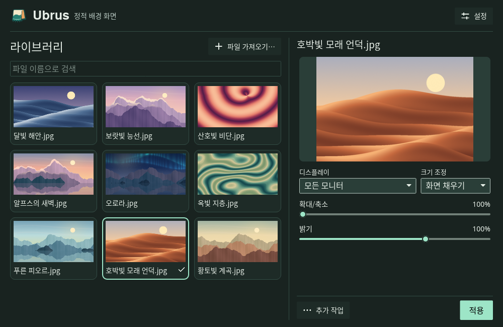

# Ubrus

[English](../../README.md) · [Русский](README.ru.md) · [Čeština](README.cs.md) · [Deutsch](README.de.md) · [Bahasa Indonesia](README.id.md) · [Italiano](README.it.md) · [Nederlands](README.nl.md) · [Português (Portugal)](README.pt-PT.md) · [Türkçe](README.tr.md) · [日本語](README.ja.md) · **한국어** · [简体中文](README.zh-Hans.md) · [繁體中文](README.zh-Hant.md)

[](https://github.com/ivangor246/ubrus/actions/workflows/ci.yml)
[](https://github.com/ivangor246/ubrus/releases/latest)
[](#설치)
[](#설치)
[](#프로젝트)

GNOME에서 모니터마다 사진, 애니메이션(GIF 또는 WebP), 반복 재생 동영상을 배경 화면으로 지정할 수 있습니다. 창이 한 모니터의 배경을 완전히 가리면 해당 모니터에서 재생이 일시 정지됩니다.

**[Ubuntu용 다운로드 (.deb, amd64)](https://github.com/ivangor246/ubrus/releases/latest/download/ubrus-amd64.deb)** · [모든 릴리스 파일](https://github.com/ivangor246/ubrus/releases/latest)



## 설치

내려받은 DEB 패키지를 앱 센터에서 열거나, 패키지가 있는 폴더에서 `sudo apt install ./ubrus-amd64.deb` 명령을 실행하세요.

모든 모니터에 같은 사진을 설정하는 기능은 바로 사용할 수 있습니다. 애니메이션이나 모니터별 배경 화면을 사용하려면 GNOME에서 로그아웃한 뒤 다시 로그인하고 포함된 확장 기능을 켜세요.

```sh
gnome-extensions enable wallpaper@ubrus.org
```

Snap이나 독립 실행 버전의 압축 파일을 사용한다면 먼저 Ubrus의 ‘설정’에서 확장 기능 설치 명령을 복사하세요.

## 배경 화면 설정

Ubrus에서 ‘파일 가져오기…’를 선택해 이미지나 동영상을 추가하세요. 미리 보기 이미지와 모니터를 선택하고 필요하면 확대 비율을 조정한 뒤 ‘적용’을 누르세요. 창을 닫아도 배경 화면은 유지됩니다.

## 프로젝트

[소스에서 빌드](../development.md) · [버그 신고](https://github.com/ivangor246/ubrus/issues) · [MIT](../../LICENSE-MIT) 또는 [Apache 2.0](../../LICENSE-APACHE)

**태그** · [wallpaper-manager](https://github.com/topics/wallpaper-manager) · [animated-wallpaper](https://github.com/topics/animated-wallpaper) · [gnome-shell-extension](https://github.com/topics/gnome-shell-extension) · [rust](https://github.com/topics/rust)
