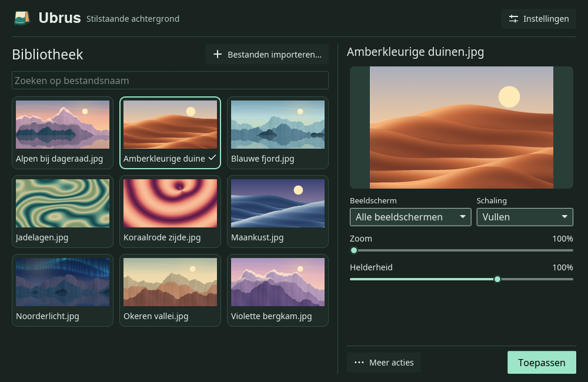

# Ubrus

[English](../../README.md) · [Русский](README.ru.md) · [Čeština](README.cs.md) · [Deutsch](README.de.md) · [Bahasa Indonesia](README.id.md) · [Italiano](README.it.md) · **Nederlands** · [Português (Portugal)](README.pt-PT.md) · [Türkçe](README.tr.md) · [日本語](README.ja.md) · [한국어](README.ko.md) · [简体中文](README.zh-Hans.md) · [繁體中文](README.zh-Hant.md)

[](https://github.com/ivangor246/ubrus/actions/workflows/ci.yml)
[](https://github.com/ivangor246/ubrus/releases/latest)
[](#installatie)
[](#installatie)
[](#project)

Geef elk beeldscherm in GNOME een eigen foto, animatie (GIF of WebP) of herhalende video. Op een scherm waar vensters de achtergrond volledig bedekken, wordt het afspelen gepauzeerd.

**[Downloaden voor Ubuntu (.deb, amd64)](https://github.com/ivangor246/ubrus/releases/latest/download/ubrus-amd64.deb)** · [Alle releasebestanden](https://github.com/ivangor246/ubrus/releases/latest)



## Installatie

Open het gedownloade DEB-pakket in het Appcentrum of voer `sudo apt install ./ubrus-amd64.deb` uit vanuit de map waarin het staat.

Je kunt meteen één foto op alle beeldschermen instellen. Voor animaties of een andere achtergrond per scherm meld je je af bij GNOME, meld je je opnieuw aan en schakel je de meegeleverde uitbreiding in.

```sh
gnome-extensions enable wallpaper@ubrus.org
```

Gebruik je de Snap of het losse archief? Open dan eerst **Instellingen** in Ubrus en kopieer de opdracht om de uitbreiding te installeren.

## Een achtergrond instellen

Kies in Ubrus **Bestanden importeren…** om afbeeldingen of video's toe te voegen. Selecteer een miniatuur en een beeldscherm, pas zo nodig de zoom aan en klik op **Toepassen**. De achtergrond blijft zichtbaar nadat je het venster sluit.

## Project

[Bouwen vanuit de broncode](../development.md) · [Een fout melden](https://github.com/ivangor246/ubrus/issues) · [MIT](../../LICENSE-MIT) of [Apache 2.0](../../LICENSE-APACHE)

**Labels** · [wallpaper-manager](https://github.com/topics/wallpaper-manager) · [animated-wallpaper](https://github.com/topics/animated-wallpaper) · [gnome-shell-extension](https://github.com/topics/gnome-shell-extension) · [rust](https://github.com/topics/rust)
