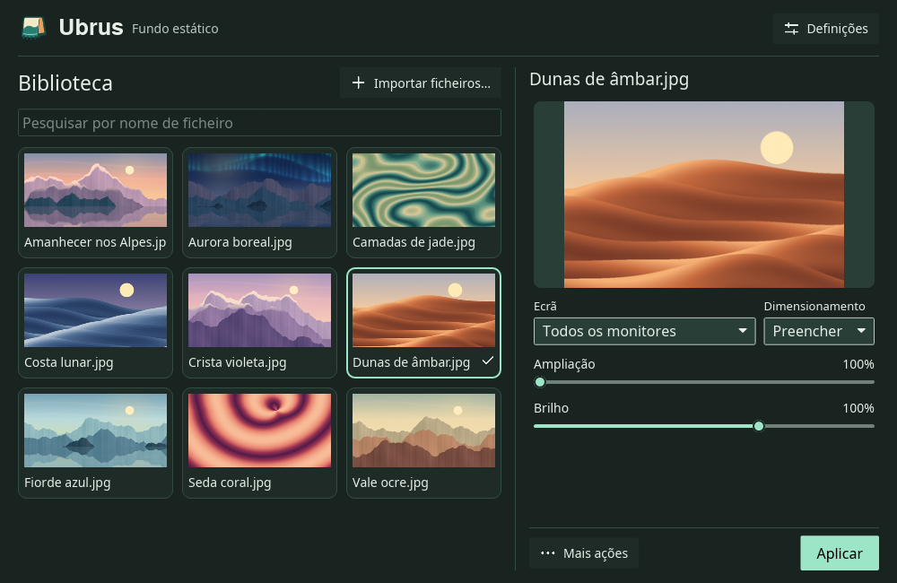

# Ubrus

[English](../../README.md) · [Русский](README.ru.md) · [Čeština](README.cs.md) · [Deutsch](README.de.md) · [Bahasa Indonesia](README.id.md) · [Italiano](README.it.md) · [Nederlands](README.nl.md) · **Português (Portugal)** · [Türkçe](README.tr.md) · [日本語](README.ja.md) · [한국어](README.ko.md) · [简体中文](README.zh-Hans.md) · [繁體中文](README.zh-Hant.md)

[](https://github.com/ivangor246/ubrus/actions/workflows/ci.yml)
[](https://github.com/ivangor246/ubrus/releases/latest)
[](#instalação)
[](#instalação)
[](#projeto)

Use uma fotografia, uma animação (GIF ou WebP) ou um vídeo em repetição como fundo de cada monitor no GNOME. A reprodução é pausada em qualquer monitor onde as janelas cubram todo o fundo.

**[Transferir para Ubuntu (.deb, amd64)](https://github.com/ivangor246/ubrus/releases/latest/download/ubrus-amd64.deb)** · [Todos os ficheiros da versão](https://github.com/ivangor246/ubrus/releases/latest)



## Instalação

Abra o DEB transferido no Centro de Aplicações ou execute `sudo apt install ./ubrus-amd64.deb` na pasta onde o guardou.

Pode usar de imediato uma fotografia em todos os monitores. Para usar animações ou fundos diferentes em cada monitor, termine a sessão do GNOME, volte a entrar e ative a extensão incluída.

```sh
gnome-extensions enable wallpaper@ubrus.org
```

Se usar o Snap ou o arquivo autónomo, abra as **Definições** do Ubrus e copie o comando para instalar primeiro a extensão.

## Definir um fundo

No Ubrus, escolha **Importar ficheiros…** para adicionar imagens ou vídeos. Selecione uma miniatura e um monitor, ajuste a ampliação se necessário e clique em **Aplicar**. O fundo mantém-se no ambiente de trabalho quando fecha a janela.

## Projeto

[Compilar a partir do código-fonte](../development.md) · [Comunicar um erro](https://github.com/ivangor246/ubrus/issues) · [MIT](../../LICENSE-MIT) ou [Apache 2.0](../../LICENSE-APACHE)

**Etiquetas** · [wallpaper-manager](https://github.com/topics/wallpaper-manager) · [animated-wallpaper](https://github.com/topics/animated-wallpaper) · [gnome-shell-extension](https://github.com/topics/gnome-shell-extension) · [rust](https://github.com/topics/rust)
