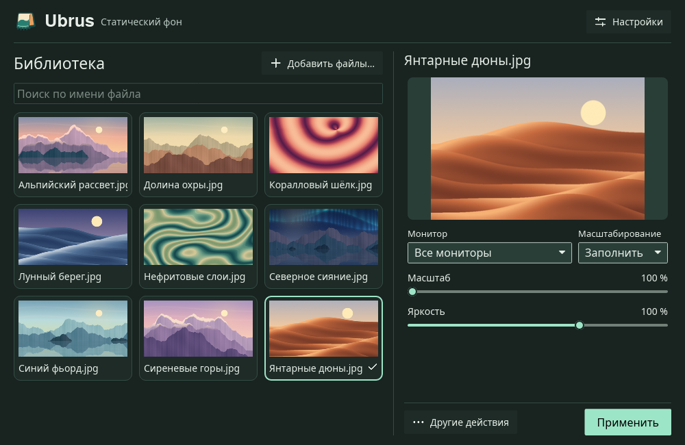

# Ubrus

[English](../../README.md) · **Русский** · [Čeština](README.cs.md) · [Deutsch](README.de.md) · [Bahasa Indonesia](README.id.md) · [Italiano](README.it.md) · [Nederlands](README.nl.md) · [Português (Portugal)](README.pt-PT.md) · [Türkçe](README.tr.md) · [日本語](README.ja.md) · [한국어](README.ko.md) · [简体中文](README.zh-Hans.md) · [繁體中文](README.zh-Hant.md)

[](https://github.com/ivangor246/ubrus/actions/workflows/ci.yml)
[](https://github.com/ivangor246/ubrus/releases/latest)
[](#установка)
[](#установка)
[](#о-проекте)

Выберите для каждого монитора свои обои в GNOME — фотографию, анимацию (GIF или WebP) или зацикленное видео. Если окна полностью закрывают фон на одном из экранов, воспроизведение на нём приостанавливается.

**[Скачать для Ubuntu (.deb, amd64)](https://github.com/ivangor246/ubrus/releases/latest/download/ubrus-amd64.deb)** · [Все файлы выпуска](https://github.com/ivangor246/ubrus/releases/latest)



## Установка

Откройте скачанный DEB в Центре приложений или выполните `sudo apt install ./ubrus-amd64.deb` в папке с файлом.

Одну фотографию для всех мониторов можно установить сразу. Для анимации или разных обоев на мониторах понадобится расширение из пакета. Выйдите из сеанса GNOME, войдите снова и выполните команду ниже.

```sh
gnome-extensions enable wallpaper@ubrus.org
```

Если вы используете Snap или архив, сначала установите расширение. Команду для вашей версии можно скопировать в **Настройках** Ubrus.

## Как выбрать обои

В Ubrus нажмите **Добавить файлы…** и откройте нужные изображения или видео. Выберите миниатюру и монитор, при желании измените масштаб и нажмите **Применить**. Окно можно закрыть — обои останутся на рабочем столе.

## О проекте

[Сборка из исходников](../development.md) · [Сообщить об ошибке](https://github.com/ivangor246/ubrus/issues) · [MIT](../../LICENSE-MIT) или [Apache 2.0](../../LICENSE-APACHE)

**Теги** · [wallpaper-manager](https://github.com/topics/wallpaper-manager) · [animated-wallpaper](https://github.com/topics/animated-wallpaper) · [gnome-shell-extension](https://github.com/topics/gnome-shell-extension) · [rust](https://github.com/topics/rust)
