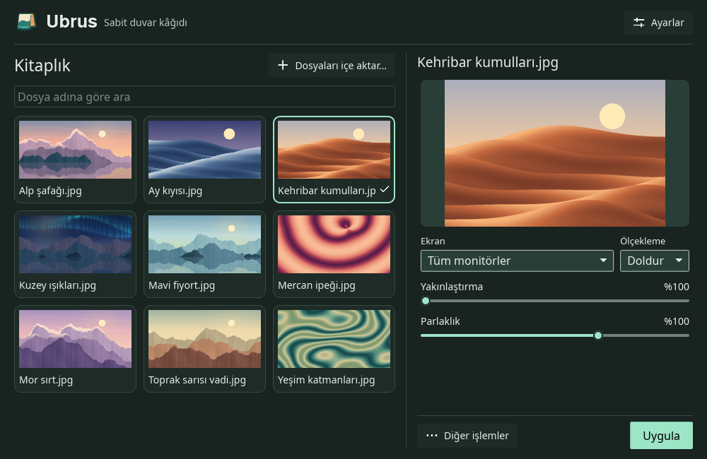

# Ubrus

[English](../../README.md) · [Русский](README.ru.md) · [Čeština](README.cs.md) · [Deutsch](README.de.md) · [Bahasa Indonesia](README.id.md) · [Italiano](README.it.md) · [Nederlands](README.nl.md) · [Português (Portugal)](README.pt-PT.md) · **Türkçe** · [日本語](README.ja.md) · [한국어](README.ko.md) · [简体中文](README.zh-Hans.md) · [繁體中文](README.zh-Hant.md)

[](https://github.com/ivangor246/ubrus/actions/workflows/ci.yml)
[](https://github.com/ivangor246/ubrus/releases/latest)
[](#kurulum)
[](#kurulum)
[](#proje)

GNOME'da her monitöre ayrı bir fotoğraf, animasyon (GIF veya WebP) ya da döngüde oynatılan video atayabilirsiniz. Pencereler bir monitörün arka planını tamamen kapladığında o monitörde oynatma duraklar.

**[Ubuntu için indir (.deb, amd64)](https://github.com/ivangor246/ubrus/releases/latest/download/ubrus-amd64.deb)** · [Tüm sürüm dosyaları](https://github.com/ivangor246/ubrus/releases/latest)



## Kurulum

İndirdiğiniz DEB paketini Uygulama Merkezi'nde açın veya paketin bulunduğu klasörde `sudo apt install ./ubrus-amd64.deb` komutunu çalıştırın.

Tüm monitörlerde aynı fotoğrafı hemen kullanabilirsiniz. Animasyon veya her monitörde farklı bir duvar kâğıdı için GNOME oturumunu kapatıp yeniden açın ve paketle gelen uzantıyı etkinleştirin.

```sh
gnome-extensions enable wallpaper@ubrus.org
```

Snap veya bağımsız arşivi kullanıyorsanız önce Ubrus'ta **Ayarlar** bölümünü açın ve uzantıyı kurma komutunu kopyalayın.

## Duvar kâğıdı ayarlama

Ubrus'ta **Dosyaları içe aktar…** seçeneğiyle görsel veya video ekleyin. Bir küçük resim ve monitör seçin, gerekirse yakınlaştırmayı ayarlayın ve **Uygula** düğmesine basın. Pencereyi kapattığınızda duvar kâğıdı masaüstünde kalır.

## Proje

[Kaynaktan derleme](../development.md) · [Hata bildir](https://github.com/ivangor246/ubrus/issues) · [MIT](../../LICENSE-MIT) veya [Apache 2.0](../../LICENSE-APACHE)

**Etiketler** · [wallpaper-manager](https://github.com/topics/wallpaper-manager) · [animated-wallpaper](https://github.com/topics/animated-wallpaper) · [gnome-shell-extension](https://github.com/topics/gnome-shell-extension) · [rust](https://github.com/topics/rust)
