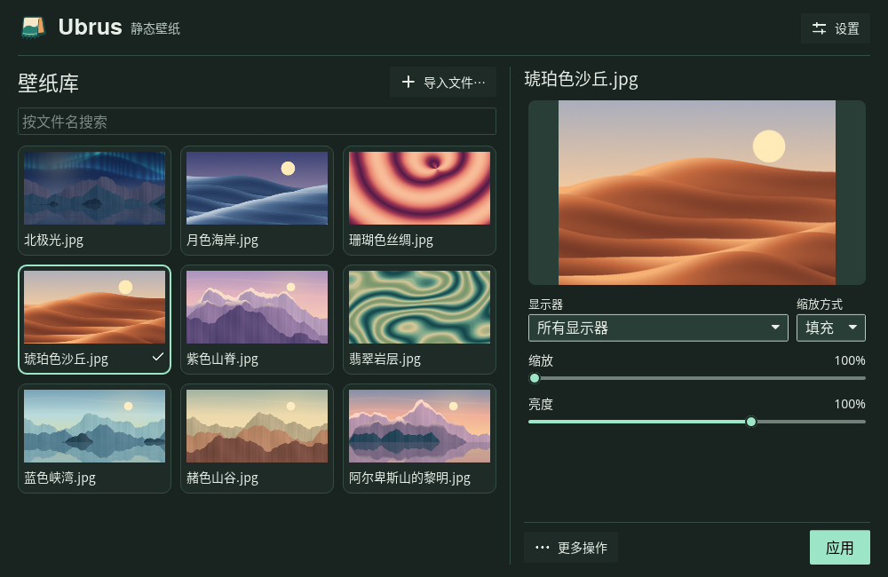

# Ubrus

[English](../../README.md) · [Русский](README.ru.md) · [Čeština](README.cs.md) · [Deutsch](README.de.md) · [Bahasa Indonesia](README.id.md) · [Italiano](README.it.md) · [Nederlands](README.nl.md) · [Português (Portugal)](README.pt-PT.md) · [Türkçe](README.tr.md) · [日本語](README.ja.md) · [한국어](README.ko.md) · **简体中文** · [繁體中文](README.zh-Hant.md)

[](https://github.com/ivangor246/ubrus/actions/workflows/ci.yml)
[](https://github.com/ivangor246/ubrus/releases/latest)
[](#安装)
[](#安装)
[](#项目)

在 GNOME 中，可以为每台显示器分别设置照片、动画（GIF 或 WebP）或循环播放的视频。某台显示器的背景被窗口完全遮挡时，该显示器上的播放会暂停。

**[下载 Ubuntu 版 (.deb, amd64)](https://github.com/ivangor246/ubrus/releases/latest/download/ubrus-amd64.deb)** · [所有发布文件](https://github.com/ivangor246/ubrus/releases/latest)



## 安装

用应用中心打开下载的 DEB 软件包，或在文件所在的文件夹中运行 `sudo apt install ./ubrus-amd64.deb`。

可以直接为所有显示器设置同一张照片。如需播放动画或为每台显示器设置不同壁纸，请注销 GNOME 后重新登录，然后启用随附的扩展。

```sh
gnome-extensions enable wallpaper@ubrus.org
```

如果使用 Snap 或独立版压缩包，请先打开 Ubrus 的“设置”，复制并运行扩展安装命令。

## 设置壁纸

打开 Ubrus，选择“导入文件…”以添加图片或视频。选择缩略图和显示器，根据需要调整缩放，然后点击“应用”。关闭窗口后，壁纸会保留在桌面上。

## 项目

[从源码构建](../development.md) · [报告问题](https://github.com/ivangor246/ubrus/issues) · [MIT](../../LICENSE-MIT) 或 [Apache 2.0](../../LICENSE-APACHE)

**标签** · [wallpaper-manager](https://github.com/topics/wallpaper-manager) · [animated-wallpaper](https://github.com/topics/animated-wallpaper) · [gnome-shell-extension](https://github.com/topics/gnome-shell-extension) · [rust](https://github.com/topics/rust)
