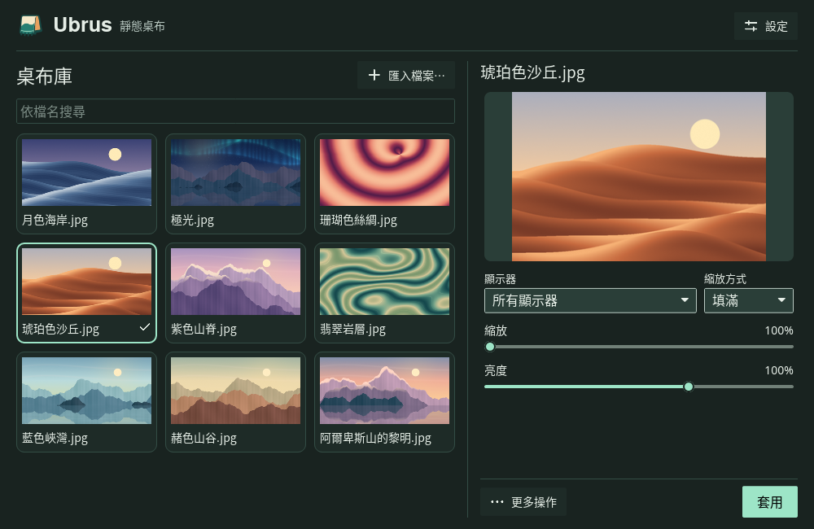

# Ubrus

[English](../../README.md) · [Русский](README.ru.md) · [Čeština](README.cs.md) · [Deutsch](README.de.md) · [Bahasa Indonesia](README.id.md) · [Italiano](README.it.md) · [Nederlands](README.nl.md) · [Português (Portugal)](README.pt-PT.md) · [Türkçe](README.tr.md) · [日本語](README.ja.md) · [한국어](README.ko.md) · [简体中文](README.zh-Hans.md) · **繁體中文**

[](https://github.com/ivangor246/ubrus/actions/workflows/ci.yml)
[](https://github.com/ivangor246/ubrus/releases/latest)
[](#安裝)
[](#安裝)
[](#專案)

在 GNOME 中，您可以為每部顯示器個別設定照片、動畫（GIF 或 WebP）或循環播放的影片。當視窗完全遮住某部顯示器的背景時，該顯示器上的播放會暫停。

**[下載 Ubuntu 版 (.deb, amd64)](https://github.com/ivangor246/ubrus/releases/latest/download/ubrus-amd64.deb)** · [所有發行檔案](https://github.com/ivangor246/ubrus/releases/latest)



## 安裝

使用應用程式中心開啟下載的 DEB 套件，或在檔案所在的資料夾中執行 `sudo apt install ./ubrus-amd64.deb`。

您可以直接為所有顯示器設定同一張照片。如需播放動畫或為各顯示器設定不同桌布，請先登出 GNOME 再重新登入，然後啟用隨附的擴充套件。

```sh
gnome-extensions enable wallpaper@ubrus.org
```

如果使用 Snap 或獨立版壓縮檔，請先開啟 Ubrus 的「設定」，複製並執行安裝擴充套件的指令。

## 設定桌布

開啟 Ubrus，選擇「匯入檔案…」來加入圖片或影片。選擇縮圖和顯示器，視需要調整縮放比例，再點選「套用」。關閉視窗後，桌布仍會保留在桌面上。

## 專案

[從原始碼建置](../development.md) · [回報問題](https://github.com/ivangor246/ubrus/issues) · [MIT](../../LICENSE-MIT) 或 [Apache 2.0](../../LICENSE-APACHE)

**標籤** · [wallpaper-manager](https://github.com/topics/wallpaper-manager) · [animated-wallpaper](https://github.com/topics/animated-wallpaper) · [gnome-shell-extension](https://github.com/topics/gnome-shell-extension) · [rust](https://github.com/topics/rust)
